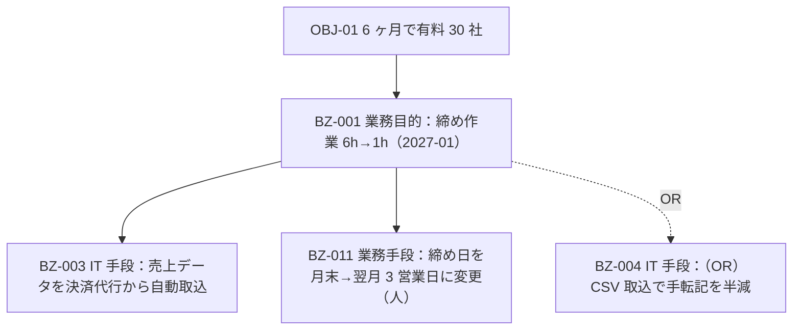

# 業務要件一覧（docs/03-requirements/business-requirements.md）

> この文書について：本書は、現状の問題・課題から業務の目的・目標と実現手段を導き、すべての業務要件とその優先度・採否を一覧にしたものである。RFP の達成目標 OBJ を最上位に、業務目的（なぜ）→ 手段（何をするか。業務手段と IT 手段）の階層で全要求に BZ-NNN を振る。後工程の機能一覧（F-NNN）はこの表の IT 手段行を親に持つ。requirements-architect が Phase 2 で作成し、Phase 3 で requirements-reviewer が問題⇄要求の照合、RFP との対応、採否の妥当性を見る。
> 関連文書：RFP 分析表（docs/01-rfp/rfp-analysis.md）／要件定義書（requirements.md）／ユースケース一覧（use-cases.md）／要確認事項一覧（open-questions.md）／決定ログ（decision-log.md）
> 記述規約：`.claude/skills/requirements-toolkit/references/writing-rules.md`。目標の述語は MEDIC（維持・廃止・削減・増加・創出）。「強化」「改善」禁止。

- **作成日**：YYYY-MM-DD　**作成者**：requirements-architect　**版**：v0.1（draft）
- **上位文書**：rfp-analysis.md §2（OBJ-01〜。KPI-01〜は RFP に記載がある場合のみ）

## 1. 問題・ニーズ・課題一覧

要求の**源泉**。抽出時は原因・影響を 1 つずつ簡潔に書く（因果分析に深入りしない）。要件定義の後半で §3 の要求と照合し、問題に対応する要求が無いもの／要求に対応する問題が無いものを洗い出す（取りこぼし・膨張の検出）。

| ID | 抽出テーマ | 提起者（ロール） | 問題（事実・定量値） | 影響（定量値） | 原因（真因 1 つ） | ニーズ | 課題（解決テーマ） | 対応する要求 BZ | 出所（RFP-NNN） | 備考 |
|----|-----------|----------------|---------------------|---------------|------------------|--------|-------------------|----------------|----------------|------|
| P-001 | 月次締め業務 | 経理担当（SH-02） | 月次締めに 6 時間/月かかる | 月末 2 日間は他業務停止 | 売上データを手で転記している（転記 120 件/月） | 締めを半日で終えたい | 手転記を無くす | BZ-003、BZ-011 | RFP-002 | |
| P-002 | | | | | | | | | | |

問題の原因は**制約（お金・人）に行き着いたら止める**。制約は課題にしない（自分たちで解決できないため）。解決ポイントは「定量効果が大きい」「悪循環を起こしている」問題を優先する。

## 2. 要求構造（OBJ → 業務目的 → 手段）

全要求を「目的」と「手段」に分け、階層で結ぶ。下位が目的なら AND、下位が手段なら AND か OR を明示する（省略時 AND）。**人の手段（運用・ルール）と IT 手段の両方**を置く。妥当性（下 → 上：この手段はこの目的に効くか）と十分性（上 → 下：この手段群で目的は達成できるか）を確認してから §3 を確定する。

（任意）OBJ と機能を結ぶリザルトチェーン（IT 施策 → 機能 → 業務への影響 → 中間成果 → 最終成果。前提条件とマイナス影響の打ち消し施策付き）を描く場合もここに置く。

## 3. 要求一覧（BZ）

### 3.1 目的系要求（業務目的・目標）

| ID | 業務目的（状態の変化） | 親 OBJ | 測定尺度（タイムリーに測れる値） | 現状値（測定時期） | 目標値（達成時期） | KGI/KPI 対応 | 提起者 | 源泉 P | 出所（RFP-NNN） | 採否 | 備考 |
|----|----------------------|--------|-------------------------------|------------------|------------------|-------------|--------|--------|----------------|------|------|
| BZ-001 | 月次締め作業の時間を削減する | OBJ-01 | 締め作業時間（h/月） | 6h（2026-10） | 1h（2027-01） | KGI | 経理担当（SH-02） | P-001 | RFP-002 | 採用 | |
| BZ-002 | | | | | | | | | | | |

- 測定尺度は間接的でもよい。システムのログ・分析ツールから自動取得できる値を優先する
- RFP に KPI が無い場合、測定可能な目標はこの表（測定尺度・現状値・目標値）が正本になる。業務レベル KPI を追加した場合は発注者の合意を取る
- 出所が空欄の行（ヒアリング由来の追加要求）は、RFP 範囲外の追加であることを備考に書き、採否を発注者と合意する

### 3.2 手段系要求（業務手段・IT 手段）

| ID | 種別 | 手段（実施すること） | 親 BZ（目的） | AND/OR | 有効性 | 必要性 | 緊急性 | 費用（開発＋運用） | 実現性（技術/人的） | 新たな問題と予防 | MoSCoW | 採否 | 出所（RFP-NNN） | 備考 |
|----|------|--------------------|--------------|--------|--------|--------|--------|------------------|-------------------|-----------------|--------|------|----------------|------|
| BZ-003 | IT 手段 | 売上データを決済代行から自動取込する | BZ-001 | AND | 大 | 中 | 中 | 小 / 月額 0 | ○ / ○ | Webhook 失敗時の欠落 → 日次再取込 JOB | Must | 採用 | RFP-001 | 後工程で機能一覧 F-NNN に展開 |
| BZ-004 | IT 手段 | CSV 取込で手転記を半減する | BZ-001 | OR（BZ-003 と） | 中 | 低 | 低 | 小 | ○ / ○ | | Could | 棄却（BZ-003 で十分） | — | D-004 |
| BZ-011 | 業務手段 | 締め日を翌月 3 営業日に変更する（人） | BZ-001 | AND | 中 | 低 | 低 | 0 | ○ / 発注者の合意要 | 発注者の経理規程と衝突 → OQ-003 | Should | 採用 | — | 運用で実施。機能化しない |
| BZ-012 | IT 手段 | | | | | | | | | | | 先送り（次期） | | |

**採点ルール**（6 基準。粗く 3 段階 → 境界線上だけ精査）：

- 有効性＝目的・目標への貢献（定量効果は算出根拠付き）／必要性＝法制度・内部統制・社会的責任・将来性／緊急性＝期限の有無／費用＝開発費＋**運用の手間と月額ランニング**／実現性＝技術（実績の少ない技術のリスク）と人的（体制で作って運用できるか）／新たな問題＝実現すると生まれる問題とその対処
- 得点化する場合は 5 点満点、**コストは低いほど高得点**、目安は 3 段階、カテゴリ小計を出す。評価は**要求の提示元**が行う（RFP の要求は発注者）
- **採否は優先度と別の列**。値：採用／先送り（次期候補）／棄却（理由）／保留（OQ）。棄却・先送りの行は削除せず残す（蒸し返し防止）
- **RFP の全要求を MUST にしない**。RFP で必須と明記された要求を Should 以下・棄却・先送りにする場合は、OQ にして発注者の合意を取る

## 4. 業務パターン表（MVP の対象パターン）

顧客区分 × 契約形態 × … の組み合わせごとに辿るプロセスと頻度を書き、**上位 2 割のパターンで業務量の 8 割**を賄うことを確認する。滅多に無いパターンは統合するか、業務運用（サポート・手動）でカバーし、MVP から外す根拠にする。

| ID | 頻度（件/月） | 区分 1（例：法人/個人） | 区分 2（例：月額/年額） | 区分 3 | 辿るプロセス（順序） | MVP | 対象外の場合の運用 |
|----|-------------|------------------------|------------------------|--------|---------------------|-----|------------------|
| PT-1 | 300 | 個人 | 月額 | — | 登録 → トライアル → 課金 → 利用 | ○ | |
| PT-4 | 1 | 法人 | 年額・請求書払い | 複数拠点 | 登録 → 見積 → 請求書 → 入金確認 → 利用 | × | 手動で Stripe Invoice 発行（サポート対応） |

## 5. 問題 ⇄ 要求 照合結果

| 観点 | 件数 | 対応 |
|------|------|------|
| 対応する要求の無い問題 | 0 | （あれば P-No を列挙し、OQ か「対象外（理由）」にする） |
| 源泉の無い要求 | 0 | （あれば BZ を列挙し、源泉を書くか棄却する） |
| 妥当性 NG（上位目的に効かない手段） | 0 | |
| 十分性 NG（目的を達成するのに手段が不足） | 0 | |

## 6. 変更履歴（ベースライン以降）

| ID | 日付 | 変更内容 | 影響（UC / NFR / RFP-NNN） | 判断（decision-log） |
|----|------|---------|--------------------------|---------------------|
| BZ-0xx | | | | |

決定済みの要求を大きく変える場合は、当事者間で受け入れず、影響と効果を比べて PM・発注者が判定する（`requirements-management.md` §3）。

## ✅ Self-Check（提出前セルフレビュー）

- [ ] 全 BZ に親（OBJ または目的系 BZ）がある（中抜けなし：OBJ → 業務目的 → 手段）
- [ ] 目的系 BZ の全行に測定尺度・現状値・目標値・達成時期がある。述語は MEDIC
- [ ] 手段系 BZ に業務手段（人）が 1 つ以上ある。全部 IT 手段になっていない
- [ ] OR 関係の手段は OR と明示し、採用は 1 つに決めている
- [ ] 採否列が全行埋まり、棄却・先送りに理由がある
- [ ] 出所（RFP-NNN）列が埋まり、空欄の行はヒアリング由来の追加として発注者の合意対象になっている
- [ ] RFP の全要求を MUST にしていない。RFP で必須の要求を下げた行に OQ がある
- [ ] §5 の照合が 4 観点とも 0 件、または残件が OQ になっている
- [ ] 「現行踏襲」「現状通り」を手段として書いていない
- [ ] writing-rules §7 の推敲手順を実施した（禁止語の残存 0 件）
