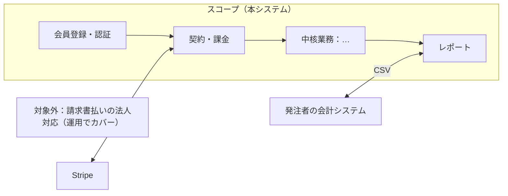
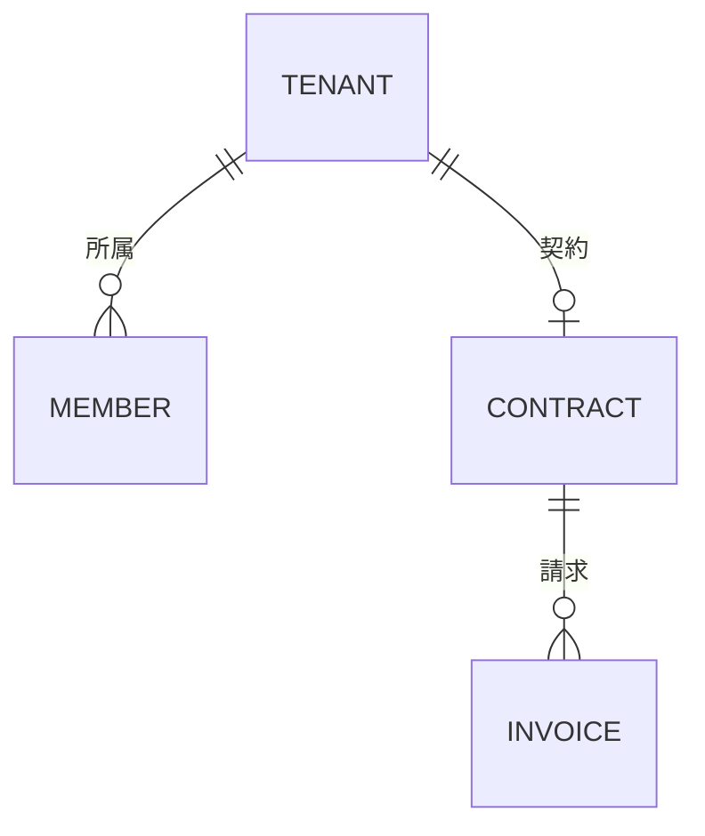
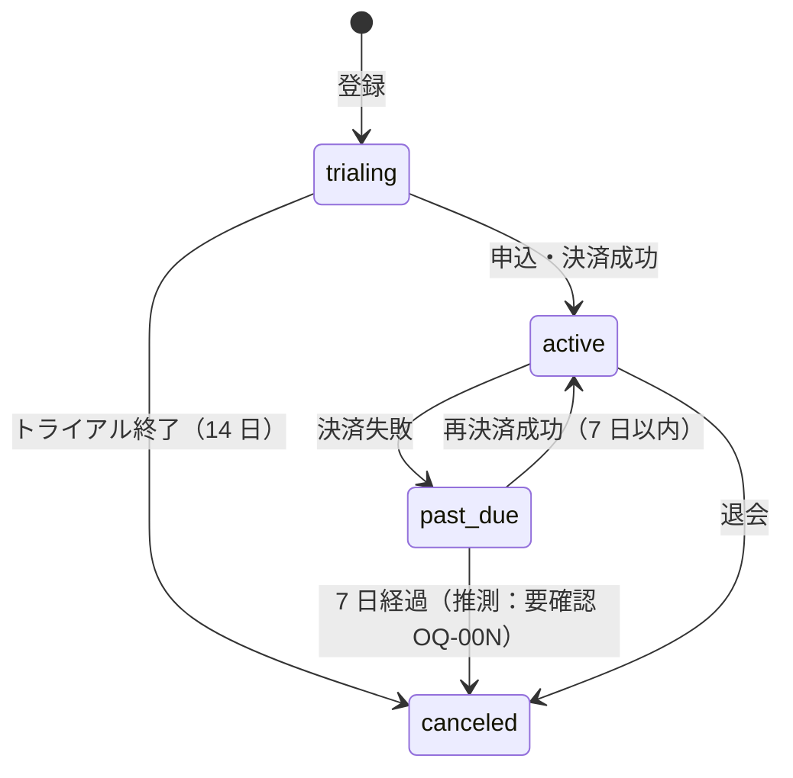

# 要件定義書（docs/03-requirements/requirements.md）

> この文書について：本書は、ご提示いただいた RFP に基づき、本システムの目的・対象範囲・業務の要件・非機能要件・受入基準・投資と効果をまとめた要件定義の正本である。業務要件（BZ）・ユースケース（UC）・非機能（NFR）・権限（ROLE）・用語・未決（OQ）は別冊に置き、本書は要約と参照を持つ。requirements-architect が Phase 2 で作成し、Phase 3 で requirements-reviewer がレビューする。上流は RFP（docs/00-inputs/）と RFP 分析表（docs/01-rfp/rfp-analysis.md）。
> 関連文書：RFP 分析表（docs/01-rfp/rfp-analysis.md）／業務要件一覧（business-requirements.md）／ユースケース一覧（use-cases.md）／非機能要件一覧（non-functional.md）／ロール・権限（permissions-matrix.md）／用語集（glossary.md）／要確認事項（open-questions.md）／決定ログ（decision-log.md）
> 記述規約：`.claude/skills/requirements-toolkit/references/writing-rules.md`。文書の粒度・台帳の書式：`document-guide.md`

- **案件名**：　**発注者**：　**モード**：A（クライアント案件）／B（自社プロダクト）（rfp-analysis.md §1 から転記）
- **作成日**：YYYY-MM-DD　**版**：v0.1（draft）　**作成者**：requirements-architect　**最終承認者**：
- **文書セット**：docs/99-pm/document-set.md

## 0. 文書構成（この案件で作る文書と参照関係）

```
requirements.md（本書）
 ├─ 参照：RFP 原本／rfp-analysis.md（RFP-NNN・OBJ）
 ├─ business-requirements.md（BZ）── use-cases.md（UC）／non-functional.md（NFR）
 ├─ permissions-matrix.md（ROLE）／glossary.md／open-questions.md → decision-log.md
 └─ 後工程（本書の範囲外）：機能一覧（F ← BZ）／業務フロー／データモデル／テスト（← UC）
除外した文書：（document-set.md の除外行と理由をここに 1 行ずつ）
```

## 1. 案件概要

- **一文で**：（本システムが実現すること。RFP の目的から）
- **解決する課題**：（RFP の背景を定量化したもの。詳細は business-requirements.md §1）
- **案件の背景・きっかけ**：（RFP の背景。出典：rfp-analysis.md §1）

## 2. RFP からの確定事項（転記）

RFP から転記した確定事項。変更が必要な場合は要件で書き換えず、OQ にして発注者に確認する。

| 項目 | 内容 | 出所（RFP の章節／RFP-NNN） |
|------|------|--------------------------|
| 達成目標 | OBJ-01（…）／OBJ-02（…） | rfp-analysis.md §2 |
| KPI（記載がある場合） | KPI-01（…） | rfp-analysis.md §2 |
| 対象業務・対象範囲 | | RFP §… ／RFP-0xx |
| 対象利用者 | （SH-NN・ROLE-NN に展開） | RFP §… ／RFP-0xx |
| 提出物・納期 | | RFP §… ／RFP-0xx |
| 予算 | | RFP §… ／RFP-0xx |
| 期限（稼働希望時期） | | RFP §… ／RFP-0xx |
| 必須／禁止の技術・環境 | | RFP §… ／RFP-0xx |
| 法令・規程 | | RFP §… ／RFP-0xx |
| 対象外（RFP が明記したもの） | | RFP §… ／RFP-0xx |

RFP の曖昧・矛盾・欠落：open-questions.md の OQ-NNN（種別：RFP 曖昧／RFP 矛盾／RFP 欠落）を参照。

## 3. ステークホルダ

### 3.1 一覧

| ID | ステークホルダ | 区分（直接／間接） | 役割（意思決定／実行／相談／報告） | 影響度 | 関心度 | 関与（ヒアリング／レビュー／承認） | 出所（RFP-NNN） | 対応方針・備考 |
|----|---------------|------------------|--------------------------------|--------|--------|--------------------------------|----------------|---------------|
| SH-01 | 発注者の決裁者 | 直接・評価者 | 意思決定 | 大 | 中 | 承認 | RFP-001 | 費用・稼働時期に関心。意見衝突時のエスカレーション先 |
| SH-02 | 発注者の業務担当（ROLE-02） | 直接・最終利用者 | 実行／レビュー | 大 | 大 | ヒアリング・UAT | RFP-003 | 現行業務の情報源 |
| SH-03 | 運用担当（ROLE-09） | 直接・運用者 | 実行 | 中 | 大 | レビュー | RFP-0xx | 運用体制は RFP の運用条件に従う |
| SH-04 | 決済代行（外部システム） | 間接 | — | 中 | — | 仕様確認 | — | Webhook・税処理の制約 |

### 3.2 対立・関連（リッチピクチャ）


合意が難しい課題（対立が多い・提示者が多い）：（列挙し、business-requirements.md §1 の P-No へ）

## 4. 現状（As-Is）

- **業務シナリオ**：（今この業務をどう済ませているか。1 回の処理を最初から最後まで。RFP の現状記述を起点に）
- **既存システム・資料**：（RFP 別紙・既存ツール・Excel・規程・マニュアル。最新性と差異。持ち込み資料一覧で管理）
- **調査方法**：（操作／インタビュー／観察／シャドーイング／リバースのどれを実施したか）
- 問題・課題の一覧は business-requirements.md §1。「現行踏襲」は要求として受け入れていない（受け入れた箇所があれば理由）

## 5. 要求構造の要約

- 要求構造図と全 BZ は business-requirements.md §2-3。ここでは OBJ ごとに業務目的（BZ）と主要手段を 1 行ずつ要約する

| ID | 業務目的（BZ） | 目標（測定尺度・現状 → 目標・期日） | 主要手段（BZ） | 採用件数（Must/Should/Could） |
|----|---------------|-----------------------------------|---------------|---------------------------|
| OBJ-01 | BZ-001 … | 締め作業 6h → 1h（2027-01） | BZ-003（IT）／BZ-011（業務） | 2/1/0 |

## 6. スコープ

### 6.1 業務スコープ（ビジネスプロセス関連図）

対象業務を 1 枚で鳥瞰し、スコープの境界と外部との情報のやり取りを示す。



### 6.2 MVP（初回リリース）に含める要求

| ID | 手段 | MoSCoW | 対応 UC | 出所（RFP-NNN） | 備考 |
|----|------|--------|---------|----------------|------|
| BZ-003 | | Must | UC-BILLING-01 | RFP-001 | |

### 6.3 先送り（次期候補）

| ID | 手段 | 先送り理由 | 再検討時期 | 出所（RFP-NNN） |
|----|------|-----------|-----------|----------------|

### 6.4 やらないこと（棄却・対象外）

| ID | 内容 | 理由 | 発注者合意（D-NNN） |
|----|------|------|-------------------|
| RFP-005 | 提案書への概算見積の添付 | 提案書で回答する事項（要件定義の対象外） | — |
| BZ-004 | CSV 取込で手転記を半減する | BZ-003 で十分（棄却） | D-004 |

RFP の判定＝対象外の行と、business-requirements.md の棄却行を統合する。RFP の要求を対象外にした行は発注者合意を取る。

### 6.5 業務パターンの対象

business-requirements.md §4 の業務パターン表のうち、MVP で対象とするパターンと、運用でカバーするパターンを列挙する。

### 6.6 要求量とベースライン

- ベースライン（RFP の予算・期限から）：IT 手段 ≦ N 件（または概算 ¥）
- 現在：採用 N 件／先送り N 件／棄却 N 件。超過なし／超過分の扱い

## 7. 業務モデル（To-Be）

### 7.1 概念データモデル（主要エンティティと多重度）



多重度から読める業務ルール：（例：1 テナントに契約は同時に 1 つ。請求は契約が無いと発生しない）。具体値での検証例：（例：契約 1 件 → 月次請求 12 件/年）。詳細は後工程のデータモデル設計。

### 7.2 状態遷移（主要管理対象）



推測した遷移には「推測」と注記し、OQ を付ける。

### 7.3 変革ポイント（As-Is → To-Be）

| ID | 変わる業務 | As-Is | To-Be | 観点（廃止／集約／連結／並行化／システム化／人手に戻す） | 関連 BZ |
|----|-----------|-------|-------|------------------------------------------------------|---------|
| TP-01 | | | | | |

## 8. ユースケース（要約）

UC 一覧と記述は use-cases.md。ここでは業務領域ごとの UC 数と Critical UC を列挙する。

| 業務領域 | UC 数 | Critical UC（売上直結・データ毀損リスク） |
|---------|-------|------------------------------------------|

## 9. 外部インターフェース一覧

| ID | 名称 | 接続先 | 方向（出力／入力） | 既存／新規 | 方式・形式 | タイミング | 制約（レート制限・料金・障害時） | 出所（RFP-NNN） |
|----|------|--------|------------------|-----------|-----------|-----------|-------------------------------|------|
| IF-01 | 決済イベント | 決済代行（例：Stripe） | 入力（Webhook） | 新規 | HTTPS・JSON | 随時 | 署名検証・冪等性。停止時は再試行＋日次突合（NFR-OPS-03） | |
| IF-02 | 認証 | 発注者の IdP | 入出力 | 既存 | OIDC | 随時 | | RFP-0xx |
| IF-03 | 売上 CSV | 発注者の会計システム | 出力 | 新規 | CSV | 月次 | 文字コード・項目順を発注者と合意 | |

方式の詳細は後工程の基本設計で確定する。

## 10. 非機能要件（要約）

non-functional.md が正本。ここではビジネス領域の要求と、RFP の値・既定値の採用状況だけを要約する。

| カテゴリ | 主な要件（RFP の値／既定値からの差分） | 理由・出所 |
|---------|----------------------------------|-----------|
| AVL | | |
| PERF | 想定規模：利用者 … ／ピーク … ／1 年後 … | RFP-0xx |
| OPS | | |
| MIG | | |
| SEC | | |
| ENV | 月額上限 ¥… | RFP-0xx |

## 11. ロール・権限（要約）

permissions-matrix.md が正本。ロール一覧（ROLE-NN）と、権限に関する業務ルール（最終管理者の退会禁止等）を転記する。

## 12. 制約条件

| 項目 | 内容 | 出所（RFP の章節／RFP-NNN） |
|------|------|--------------------------|
| 開発予算／運用予算（月あたり上限） | | |
| 稼働希望時期と根拠 | | |
| 体制（発注者側の稼働・意思決定者の関与） | | |
| 必須／禁止の技術・ベンダー・環境 | | |
| 法的整備（利用規約・プライバシーポリシー・インボイス等） | 担当・時期 | |
| 支払い・契約条件 | | |
| 発注者の承認プロセス | | |

RFP に記載が無い項目は OQ（RFP 欠落）にする。

## 13. 運用・移行・公開の方針

- **運用**：サービス時間・計画停止・運用体制（RFP の運用条件）・サポート窓口と応答目標・月次／年次の運用スケジュール（NFR-OPS）
- **移行・データ取込**：既存データの有無・件数・クレンジング責任・リハーサル（NFR-MIG-01）
- **公開方式**：スモールスタート（招待制 → 一般公開）か一斉か。フィーチャーフラグ。並行利用と切り戻し条件（NFR-MIG-02/03）
- **教育・オンボーディング**：初回利用の案内。研修データに個人情報を使わない
- 詳細は後工程の移行設計・運用設計

## 14. 受入基準とテスト観点

### 14.1 完成の判定

- （「完成した」と判断する具体的条件。UAT の合格ライン。モード A は RFP の検収条件を転記）
- 完了判断基準の例：Critical UC の E2E 全件成功、Critical/Major 不具合 0 件、NFR-PERF-01/02 を k6 で満たす

### 14.2 受入テスト観点（後工程のテスト計画の入力）

| 観点 | 確認するシナリオ（UC） |
|------|----------------------|
| 通常処理 | |
| 異常処理（エラー・外部障害） | |
| 例外処理（業務上の例外） | |
| 特殊処理（キャンペーン・返金・アカウント統合） | |
| サイクル：日次 | |
| サイクル：月次（請求確定・プラン変更の月跨ぎ） | |
| サイクル：年次（年額更新・料金改定） | |

### 14.3 パイロット運用

- 期間・対象（利用部門・利用者数）・評価方法・本番展開の判断基準

## 15. 成功指標と撤退条件

| 時点 | 指標（OBJ／KPI-NN／BZ 目的系） | 目標値 | 測定方法 | 出所 |
|------|-----------------------------|--------|---------|------|
| 稼働後 3 ヶ月 | | | | |
| 稼働後 6 ヶ月 | | | | |
| 撤退ライン | | | | RFP に記載が無ければ OQ |

撤退時の利用者・データ対応：（データエクスポート・告知期間。NFR-MIG-04）

## 16. リスク（初出し）

| ID | リスク（プロジェクト／システム） | 影響 | 確率 | 対策・監視 |
|----|--------------------------------|------|------|-----------|
| RSK-01 | 決まらない要件 OQ-00N が期限内に決まらない | | | |
| RSK-02 | RFP の矛盾（OQ-00N）の回答が遅れ、スコープが確定しない | | | |

## 17. 投資と効果の概算（完了判断の材料）

| 区分 | 内容 | 金額・値 |
|------|------|---------|
| 投資：初期開発 | 開発工数 … 人月 ＋ 外部費用 ¥… | |
| 投資：運用（36 ヶ月） | 月額ランニング ¥… × 36 ＋ 運用稼働 | |
| 投資：コンティンジェンシー | 20〜30% | |
| 効果：定量（3 年累積） | 売上増・コスト削減（OBJ・BZ 目的系の目標値から） | |
| 効果：定性 | 5 段階評価（受益者の評価と達成コミットメント） | |
| 判断 | 着手／縮小／棚上げ／中止 のどれを推奨するか、その理由 | |

## 18. 未決事項

open-questions.md が正本。完了時点で open の OQ の件数と、先送り基準を満たしている旨をここに 1 行書く。

## 19. Before / After（決裁者向け 1 枚）

| 項目 | 内容 |
|------|------|
| 狙い | （OBJ） |
| 現状と問題点 | （定量） |
| 改革後の姿 | （図・3 つの主要ポイント） |
| 予測効果（定量／定性） | （OBJ・BZ 目的系の目標値） |
| 前提条件・要検討事項 | |

## 20. 別添

- rfp-analysis.md／business-requirements.md／use-cases.md／non-functional.md／permissions-matrix.md／glossary.md／open-questions.md／decision-log.md
- RFP 原本・参考資料の一覧、技術検証結果（PoC がある場合）

## ✅ Self-Check（提出前セルフレビュー）

- [ ] §2 の転記が RFP 原文（rfp-analysis.md の出典）と一致し、出所がある。独自に書き換えていない
- [ ] 全 RFP-NNN に対応 ID か対象外の理由がある。対象外にした RFP 要求が §6.4 に理由付きで載っている
- [ ] §3 に直接・間接のステークホルダと意思決定者がある
- [ ] §4 で「現行踏襲」を受け入れていない
- [ ] §5-6 の採用 BZ が business-requirements.md の採否列と一致し、要求量がベースラインに収まっている。RFP の全要求を MUST にしていない
- [ ] §7 の概念データモデル・状態遷移があり、推測遷移に OQ がある
- [ ] §9 外部 I/F に方向・既存/新規・方式・タイミング・障害時方針がある
- [ ] §13 運用・移行・公開方針が決まっている
- [ ] §14 に 4 観点＋3 サイクルの受入テスト観点がある
- [ ] §17 投資と効果の概算があり、縮小・中止の選択肢を検討した
- [ ] §18 の open OQ が先送り基準を満たしている
- [ ] completeness-checklist.md の全項目が ✅ または N/A
- [ ] writing-rules §7 の推敲を実施した（禁止語 0 件、1 文 200 文字以内、接続助詞「が」なし）

## 📤 Handoff

- **次フェーズ**：Phase 3 requirements-reviewer
- **発注者確認事項（RFP 改訂候補）**：OQ-…（RFP 矛盾・欠落・曖昧の未回答分）／なし
- **RFP 対応状況**：RFP-NNN 全 N 件（対応 ID あり N／対象外 N／未対応 0）
- **決まらない要件**：OQ-… （件数・先送り基準の充足）
- **要求量**：採用 N／先送り N／棄却 N（ベースライン …）
- **完了判断の材料**：§17 の推奨（着手／縮小／棚上げ／中止）
- **後工程への引き継ぎ**：BZ の IT 手段 → 機能一覧、UC → 業務フロー・テスト、NFR → 方式設計・費用見積り、§14 → テスト計画
